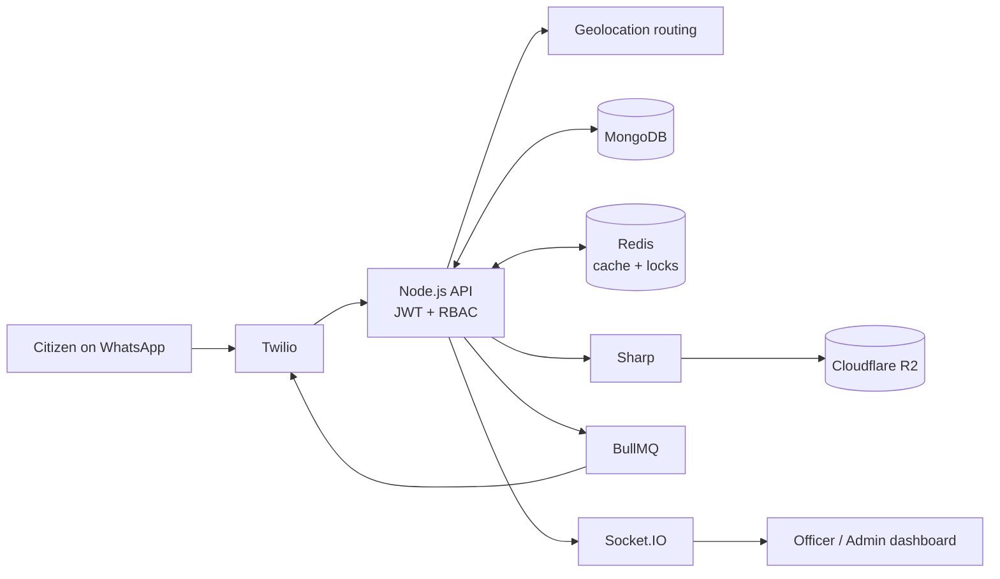

**Final-year B.Tech student at MIT Academy of Engineering, Pune, building scalable backends, real-time systems and AI-powered platforms.**

---

## About

I build backend-heavy products end to end: schema design, APIs, real-time delivery, caching, queues, and, more recently, LLM pipelines with retrieval and agentic workflows. My work ranges from a system for the **PCMC Traffic Police that was recognised by the Chief Minister of Maharashtra**, to a **zero-downtime PostgreSQL migration engine benchmarked at 10M+ rows**.

| | |
|---|---|
| **Education** | B.Tech, Electronics & Telecommunication Engineering, MIT Academy of Engineering, Pune (2023 – 2027), CGPA 8.45 / 10 |
| **Focus areas** | Backend architecture, database design, distributed systems, RAG and agentic AI |
| **Currently** | Building **Report Buddy** and agentic AI / RAG systems |
| **Recognition** | Winner, Coday Hackathon (NICE Technologies) · 300+ DSA problems on LeetCode |
| **Open to** | Internships and entry-level roles in backend, full-stack and AI engineering |

---

## Tech Stack

**Languages**

**Frontend and frameworks**

**Databases**

`pgvector` · `Pinecone` · `Mongoose`

**Messaging and real-time**

`BullMQ` · `Socket.IO` · `gRPC` · `REST` · `SSE` · `WebSockets`

**DevOps and cloud**

**AI / ML**

**Core CS:** DSA · OOP · Operating Systems · Computer Networks · DBMS · System Design · Distributed Systems
**Security and tools:** JWT · RBAC · Postman · Figma · Cursor · Antigravity · OpenCode · Hermes

---

## Featured Projects

### 🚦 Traffic Buddy: WhatsApp-first traffic complaint platform
*Built for PCMC Traffic Police · Mar 2025 – May 2025*

> 🏆 **Recognised by the Chief Minister of Maharashtra** for improving the complaint handling workflow of the PCMC Traffic Police through automated routing, real-time status tracking and streamlined resolution.

- Citizens file complaints over **WhatsApp (Twilio)**; officers and administrators work from a dashboard backed by **REST APIs** and **JWT-based RBAC**.
- **Geolocation-based routing** assigns each complaint automatically.
- Evidence is compressed with **Sharp** and stored in **Cloudflare R2**; dashboards are faster thanks to **MongoDB indexing** and **Redis cache-aside** caching.
- **Redis distributed locking** guarantees single ownership of a complaint, **Socket.IO** pushes real-time updates, and **BullMQ** sends WhatsApp notifications asynchronously.

[**Backend →**](https://github.com/RavirajSonar40/TrafficBuddy-Backend) · [**Dashboard →**](https://github.com/RavirajSonar40/TrafficDashbord)

---

### 🔍 Crime Track: crime records and analytics platform
*Jul 2025 – Sep 2025*

- Designed **normalized PostgreSQL schemas** managing **5,000+ crime records** with high data integrity.
- Optimized complex SQL queries (joins, aggregations), **reducing report generation time by 40%**.
- Built **real-time analytics dashboards and heatmaps** for faster decision-making across **3+ police zones**.

[**Repository →**](https://github.com/RavirajSonar40/crime-track1)

---

### 📝 Report Buddy: FIR management with workflow automation
*Oct 2025 – Present*

- Engineered relational schemas supporting **multi-role access for 100+ users** with strict referential integrity.
- Implemented secure **role-based authentication and authorization**, improving system security by **60%**.
- Developed **end-to-end FIR workflow automation**, **reducing manual processing time by 45%**.

<!-- Add your Report Buddy repo link here: [**Repository →**](https://github.com/RavirajSonar40/<repo-name>) -->

---

## More Projects

<table>
<tr>
<td width="50%" valign="top">

### 🧠 AI Knowledge & Action Platform
**RAG and agentic AI** · *2026*

- Semantic search, **RAG-based Q&A**, document recommendations and **multi-provider LLM** support.
- **LangGraph** workflows with task decomposition, tool execution, evidence gathering, iterative verification and **human-in-the-loop approval**.
- **Ragas-based evaluation and observability**: faithfulness, context precision, recall, latency and token usage in an **Angular dashboard**.

<!-- Add repo link: [Repository →](https://github.com/RavirajSonar40/<repo-name>) -->

</td>
<td width="50%" valign="top">

### 🔄 SafeMigrate
**Zero-downtime PostgreSQL migration engine** · *2025*

- **Logical replication / WAL (pgoutput)** with asynchronous shadow-table backfilling for live workloads.
- **Kafka-ordered change replay** and **Redis checkpoints** for idempotent crash recovery and atomic cutover with zero data loss.
- Benchmarked at **10M+ rows**: **11,655 rows/sec**, 14.30 min backfill, **zero failures**, validated with fault injection and checksum verification.

<!-- Add repo link: [Repository →](https://github.com/RavirajSonar40/<repo-name>) -->

</td>
</tr>
</table>

---

## Experience

| Role | Company | Period |
|------|---------|--------|
| **Machine Learning Engineer Intern** | Univ.Ai (Remote) | Jun 2025 – Jul 2025 |
| **WordPress Developer Intern** | Canspirits.Ai (Remote) | Jun 2024 – Jul 2024 |

- **Univ.Ai:** Built and evaluated Decision Tree and XGBoost models for loan default prediction, with preprocessing, feature engineering and EDA in Pandas and NumPy.
- **Canspirits.Ai:** Customized and maintained client WordPress sites, deployed on Bluehost with routine backups and maintenance.

---

## Achievements

- 🥇 **Winner, Coday Hackathon (NICE Technologies):** greedy and dynamic programming solution
- 🏛️ **Recognised by the Chief Minister of Maharashtra** for Traffic Buddy
- 🧩 **300+ DSA problems** solved on LeetCode (arrays, trees, graphs, DP)
- ⚡ **10M+ row zero-failure migration benchmark** with SafeMigrate

---

## GitHub Stats

---

### Let's connect

Open to internships, collaborations and interesting engineering problems.

